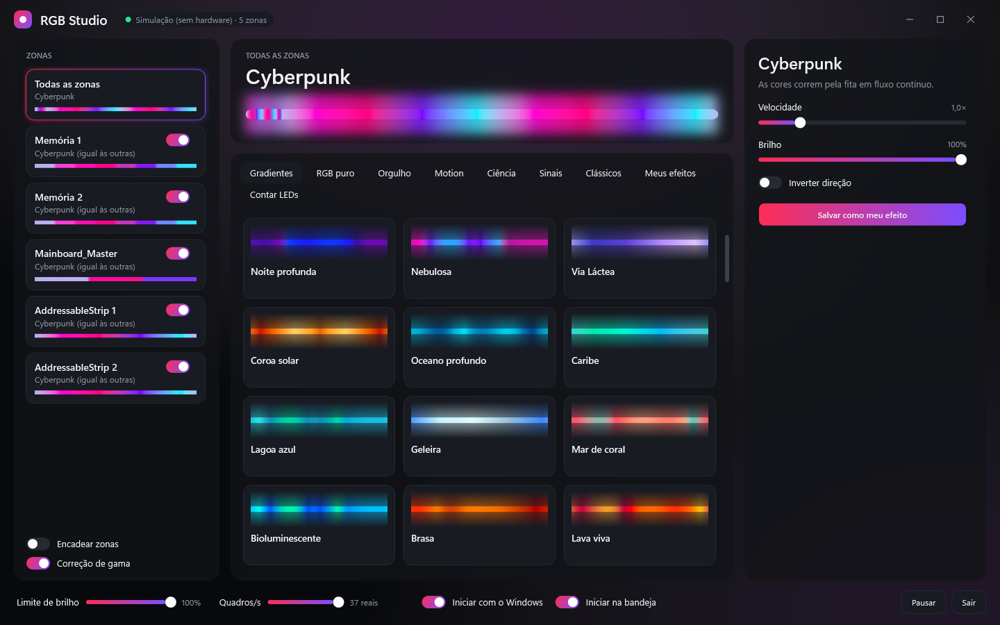
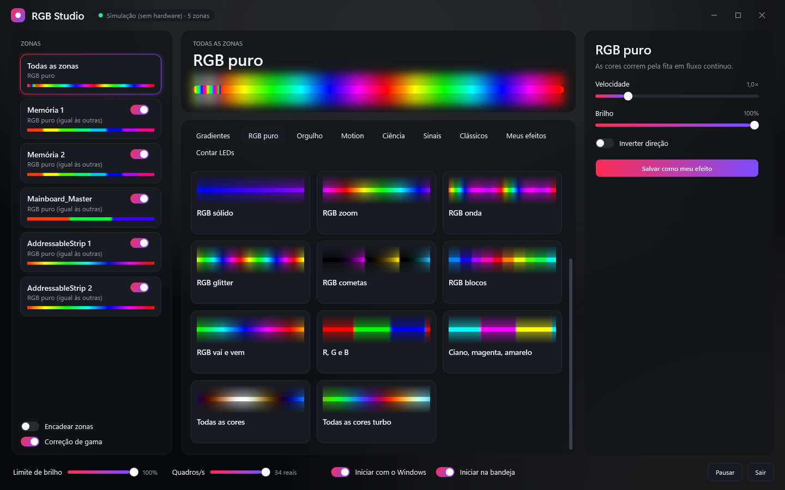

<div align="center">

# RGB Studio

**Controle de RGB para ASUS Aura, memórias RGB e Aqua Computer high flow NEXT, sem Armoury Crate e sem aquasuite.**

*RGB control for ASUS Aura, RGB RAM and the Aqua Computer high flow NEXT flow sensor — no Armoury Crate, no aquasuite.*

[](../../releases/latest)


[**Baixar**](../../releases/latest) · [O que funciona](#o-que-funciona) · [high flow NEXT](#aqua-computer-high-flow-next) · [Memórias sem Armoury Crate](#memórias-rgb-sem-armoury-crate) · [Protocolo do high flow NEXT](docs/high-flow-next.md) · [English](#english)



</div>

> [!WARNING]
> **Projeto não oficial**, sem vínculo com a ASUS nem com a Aqua Computer. Testado em **uma única máquina**. Ele fala direto com o controlador de LED da placa, com as memórias pelo SMBus e com o sensor pelo USB. Use por sua conta e risco.

## Por que existe

O Armoury Crate é pesado e o aquasuite é ótimo para refrigeração, mas cada um só cuida das suas próprias luzes. O RGB Studio junta tudo num app só, leve, que roda na bandeja:

- **Um efeito para todas as zonas**, ou um diferente em cada uma: placa, conectores ARGB, cada pente de memória e o anel do high flow NEXT.
- **Sem Armoury Crate:** as memórias vão direto pelo SMBus. Dá para desinstalar o Armoury Crate inteiro.
- **Sem aquasuite aberto:** o high flow NEXT roda os efeitos do app, ou os efeitos dele mesmo, configurados por aqui.
- **264 efeitos** e um criador simples: escolha as cores e como elas andam.

## O que funciona

| Dispositivo | Como o app fala com ele | Situação |
|---|---|---|
| Placa ASUS com Aura USB `0B05:19AF` (firmware `AULA3-AR32`) | USB HID direto | ✅ testado |
| Fitas e dispositivos nos conectores ARGB da placa | USB HID direto | ✅ testado |
| Memórias com controlador ENE (`AUDA0-E6K5-0101`), ex.: ADATA XPG Lancer RGB | SMBus direto, driver PawnIO | ✅ testado |
| Memórias pelo Aura SDK (com Armoury Crate instalado) | Aura SDK oficial | ✅ testado |
| **Aqua Computer high flow NEXT** (`0C70:F012`): anel de LEDs | USB HID, relatório `0x03` | ✅ testado |
| Aqua Computer high flow NEXT: saída RGBpx | usada pelo anel quando ele segue o app | ⚠️ parcial |
| Outros firmwares, chipsets Intel, outras placas | — | ❌ o app recusa ou ignora |

Máquina de testes: ROG Crosshair X870E Apex, ADATA XPG Lancer RGB DDR5, reservatório ARGB e um high flow NEXT, no Windows 11.

## Aqua Computer high flow NEXT

O **high flow NEXT** é o sensor de vazão da Aqua Computer, com display e um anel de LEDs RGB. Oficialmente, as luzes dele só se configuram pelo **aquasuite**. O RGB Studio controla esse anel sem o aquasuite:

- **Efeitos do app no anel:** qualquer um dos 264, sincronizado com a placa, as fitas e as memórias. Os 8 grupos de LED do sensor são espalhados pelo anel e as cores vão a até 20 quadros por segundo, só na memória temporária dele.
- **Efeitos do próprio sensor:** Onda, Arco-íris, Respirar, Vela, Chuva, Gradiente e outros, na aba **Do sensor**, com cores, brilho e a opção de **salvar no aparelho** (continua depois de desligar o PC).
- **Seguro para o sensor:** só a parte de iluminação muda; vazão, calibração e alarmes ficam como estão. Cada gravação confere o checksum CRC-16/USB, e o app para de mandar quadros se o sensor recusar três seguidos.

O mapa completo da configuração do sensor (offsets, modos, cores, checksum e comandos), descoberto para fazer isso funcionar, está em **[docs/high-flow-next.md](docs/high-flow-next.md)**. Pode ser útil para quem quer controlar o high flow NEXT no Linux, no OpenRGB ou no próprio código.

> Até onde pesquisei, o OpenRGB e o liquidctl não controlam o RGB do high flow NEXT, e o driver `aquacomputer_d5next` do Linux só lê os sensores dele.

## Memórias RGB sem Armoury Crate

Sem o Armoury Crate, o Aura SDK da ASUS vai embora junto, e com ele o controle das memórias. O RGB Studio fala direto com o controlador de luz de cada pente pelo **SMBus**, com o driver [PawnIO](https://pawnio.eu), o mesmo que o OpenRGB usa hoje. O instalador traz o PawnIO e só o instala se faltar.

O SMBus também guarda os dados de configuração dos pentes (SPD), então o app segue regras rígidas:

- **Endereços:** só `0x70` a `0x77`, onde fica o controlador de luz. `0x50` a `0x57` (SPD) é recusado no código, antes de qualquer acesso.
- **Escrita:** só registradores de cor, de modo direto e de remapeamento, e nunca o comando de salvar do controlador.
- **Firmware desconhecido:** o pente é deixado como está.
- **Barramento compartilhado:** o app pega o mutex `Access_SMBUS.HTP.Method`, compartilhado com programas de sensores.

## Efeitos

| Aba | Efeitos | Exemplos |
|---|---:|---|
| Gradientes | 91 | Pôr do sol, Aurora boreal, Nebulosa, Gasolina na água, Júpiter |
| Países | 74 | Brasil, Portugal, Argentina, Japão, Angola… em faixas da bandeira |
| Motion | 25 | Aurora, Fogo, Plasma, Oceano, Lava, Meteoros, Tempestade |
| Orgulho | 24 | bandeiras LGBTQIA+ em faixas e versões suaves |
| RGB puro | 17 | o espectro em saturação total, Todas as cores |
| Clássicos | 12 | Cor estática, Respiração, Arco-íris, Cometa, Minhas cores |
| Ciência | 12 | Ordenação (Bubble Sort), Fractal (Mandelbrot), Autômato celular, Buraco negro, Supernova |
| Sinais | 9 | Sirene policial, Giroflex, Ambulância, Semáforo, Código Morse |

**Crie os seus:** em **Meus efeitos**, escolha as cores e como elas andam (correr, faixas, cometas, blocos, vai e vem, espelho, respirar, piscar ou parado), ou crie uma cor estática com um clique.



**Cor fiel:** a correção de gama mantém o brilho que o efeito pediu, as cores se misturam em Oklab (sem tons sujos no meio) e cada zona tem calibração R/G/B.

**Limites:** teto de brilho e limite estimado de corrente por conector ARGB.

## Instalar

Baixe em [**Releases**](../../releases/latest):

| Arquivo | Para quem |
|---|---|
| `RgbStudio-<versão>-setup.exe` | **Recomendado.** Inclui o .NET e o PawnIO; cria atalhos no Menu Iniciar e na Área de Trabalho |
| `RgbStudio-win-x64.zip` | Sem instalar, inclui o .NET. Para as memórias, instale o [PawnIO](https://pawnio.eu) antes |
| `RgbStudio-win-x64-requer-dotnet10.zip` | Menor; precisa do [.NET 10 Desktop Runtime](https://dotnet.microsoft.com/download/dotnet/10.0) e do PawnIO |

- **Administrador:** o app pede ao abrir, porque o SMBus das memórias exige.
- **Primeira conexão:** leva uns 15 segundos.
- **Aviso do Windows:** pode aparecer, porque nada é assinado.
- **Desinstalar:** por Configurações > Aplicativos. Seus efeitos ficam em `%APPDATA%\RgbStudio`, e o PawnIO fica, porque outros programas também o usam.
- **Iniciar com o Windows:** opção no rodapé do app, sem pedir UAC a cada logon.

## Perguntas

**Preciso fechar o aquasuite?** Não. Mas ele aberto também acessa o sensor e pode sobrescrever o que o app muda. Com o anel seguindo o app, ele foi a causa provável de um travamento (veja abaixo).

**Posso desinstalar o Armoury Crate?** Sim, foi testado assim: placa, fitas e memórias continuam funcionando pelo app.

**Funciona com placa Intel?** As memórias, não: o app só tem o módulo de SMBus para chipsets AMD. A placa e as fitas dependem do firmware do controlador Aura, não do chipset.

**Dá para criar telas no display do high flow NEXT?** Não. O sensor tem um canal do tamanho da tela, mas ele só manda o print para o PC: imagens enviadas por ele não aparecem.

## Limitações conhecidas

- **high flow NEXT pode parar de aceitar configurações:** a 35-56 quadros/s, com o aquasuite também acessando, o sensor só voltou depois de reconectado. Desde então o app manda no máximo 20/s e para depois de 3 recusas. A medição de vazão e temperatura não foi afetada.
- **Anel em 8 cores:** são 8 grupos de LED para 10 LEDs, então dois pares vizinhos dividem a cor.
- **Remapeamento das memórias:** depois de desligar o PC sem Armoury Crate, os pentes acordam todos em `0x77` e o app os remapeia. Isso foi escrito seguindo a sequência documentada, mas ainda não foi testado num boot a frio.
- **Corrente é estimativa:** usa 60 mA por LED branco, sem medir. O padrão de 2 A por conector é conservador; confira o manual da placa antes de aumentar.
- **Azul nas memórias:** parece mais fraco nos pentes testados. A calibração por zona ajuda.
- **`EC 52 53 00 01`:** é enviado ao iniciar, como o OpenRGB faz; o efeito completo não foi verificado. Pode influenciar dispositivos ARGB Gen 2.
- **Flashes:** Sirene policial, Ambulância, Estroboscópio e o movimento Piscar piscam forte. Evite se tiver sensibilidade a luz piscando.

## Compilar

Requer o .NET 10 SDK.

```bash
dotnet test RgbStudio.Tests -c Release
dotnet publish RgbStudio/RgbStudio.csproj -c Release -o publish
```

- **Instalador:** sai de `installer\build.ps1`. Ele roda os testes, publica, baixa o instalador oficial do PawnIO conferindo o SHA-256 e compila com o [Inno Setup 6](https://jrsoftware.org/isinfo.php) (`winget install JRSoftware.InnoSetup`).
- **Sem hardware:** `dotnet RgbStudio/bin/Release/net10.0-windows/RgbStudio.dll --simulate`.
- **Testes:** são mais de 1300, cobrindo os bytes USB e SMBus, os relatórios do high flow NEXT, todos os efeitos, os limites e as configurações.

## English

**RGB Studio** is a free, open-source Windows app to control RGB lighting without vendor software:

- **ASUS Aura** motherboards with the Aura USB controller (`0B05:19AF`, firmware `AULA3-AR32`) and their ARGB headers, over USB HID.
- **RGB RAM** with ENE controllers (e.g. ADATA XPG Lancer RGB) **without Armoury Crate**, over SMBus through the PawnIO driver, with the SPD range refused in code.
- **Aqua Computer high flow NEXT** flow sensor: control its **RGB LED ring without aquasuite**. Run any of the app's 264 effects on it, or set and save the sensor's own effects. The settings report layout (offsets, modes, HSV colors, CRC-16/USB, save command) is documented in [docs/high-flow-next.md](docs/high-flow-next.md).

Unofficial, tested on one machine (ROG Crosshair X870E Apex). The UI is in Portuguese.

## Créditos

- [OpenRGB](https://codeberg.org/OpenRGB/OpenRGB) e [liquidctl](https://github.com/liquidctl/liquidctl): documentação viva dos protocolos Aura USB e ENE SMBus. O código deste projeto foi escrito do zero, sem copiar o deles.
- Driver Linux [`aquacomputer_d5next`](https://docs.kernel.org/hwmon/aquacomputer_d5next.html): offsets dos sensores e o formato de checksum dos aparelhos Aqua Computer.
- [PawnIO](https://pawnio.eu), de namazso: o driver e o módulo de SMBus (`SmbusPIIX4.bin`, LGPL-2.1, em `RgbStudio/ThirdParty/PawnIO`).
- [Oklab](https://bottosson.github.io/posts/oklab/), de Björn Ottosson: mistura perceptual de cores.
- [WLED](https://kno.wled.ge/features/effects/) e [FastLED](https://github.com/FastLED/FastLED): ideias de efeitos, gama, calibração e limite de corrente.

ASUS, Aura e Armoury Crate são marcas da ASUSTeK. Aqua Computer, high flow NEXT e aquasuite são marcas da Aqua Computer GmbH & Co. KG. Este projeto não é afiliado nem endossado por elas.

## Licença

MIT. Veja [LICENSE](LICENSE). O módulo do PawnIO segue a LGPL-2.1, e o driver PawnIO, incluído no instalador sem modificação, a GPL-2.0.

<sub>Palavras-chave: Aqua Computer high flow NEXT RGB, controlar LED do high flow NEXT sem aquasuite, alternativa ao aquasuite, alternativa ao Armoury Crate, ASUS Aura sem Armoury Crate, ADATA XPG Lancer RGB sem Armoury Crate, memória RGB SMBus, ENE DRAM, PawnIO, RGBpx, OpenRGB alternativa. high flow NEXT RGB control without aquasuite, Armoury Crate alternative, RGB RAM without Armoury Crate.</sub>
